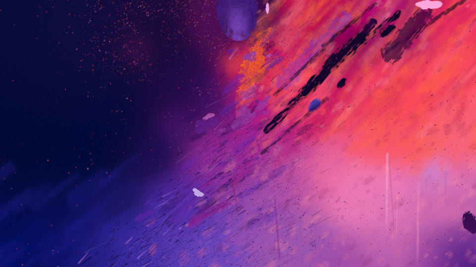

# Cosmic Abstraction

A single-pass GLSL painting: a dark night sky in the upper left, torn open
along a diagonal into violet, magenta and orange paint. It recreates
`reference/reference_less.png` procedurally, with no textures and no buffers,
and runs as-is on Shadertoy.



## How it is built

The image is a "stamp collage": a hand-authored colour field plus SDF stamps
with a dry-brush paint look. A bristle comb then drags the wet paint along the
tear, and crisp marks go on top. All shading happens in linear RGB.

| Stage | File         | What it does                                                                        |
| ----- | ------------ | ----------------------------------------------------------------------------------- |
| paint | `paint.glsl` | colour field, coral front, washes, mottle, dry brush, smudges, tear chunks          |
| smear | `smear.glsl` | bristle drag: each bristle picks up paint upstream (the background evaluated again) |
| marks | `marks.glsl` | dust haze, slashes, grit, ink dust, drips, top violet streak, pale flakes           |
| grade | `grade.glsl` | chroma boost, film grain                                                            |

Strokes run at 35° along the tear, about 50° in the warm top right and
vertically in the burst. `iTime` slowly drifts the strokes along the tear,
and the dust dots drift and twinkle; t = 0 is the scored frame.

The `shaders/main.glsl` header lists every layer and the debug defines
(`-D NO_SMEAR=1`, `-D SHOW_FIELD=1`, `-D SHOW_PAINT=1`).

## Usage

Requires Go and [just](https://github.com/casey/just); the window mode needs
GLFW (`libgl1-mesa-dev xorg-dev` on Debian/Ubuntu).

```sh
just run                  # window with hot reload (Space pauses, P saves a PNG)
just shot 0,15            # offscreen frames into out/
just compare              # out/shot.png + out/shot_cmp.png against the reference
just score                # imgstat style score (lower = better)
just diff                 # dE heatmap and orientation difference
just bench                # frame time at 1456x816 and 2x
just bundle               # Shadertoy export into out/shadertoy.glsl
```

The reference image is not versioned; put it at `reference/reference_less.png`
to use `compare`, `score` and `diff`. Go needs `-buildvcs=false` here (stray
`/mnt/projekte/Code/.git`); the justfile sets it.

## Layout

| Path                                                                 | Content                                                                              |
| -------------------------------------------------------------------- | ------------------------------------------------------------------------------------ |
| `shaders/main.glsl`                                                  | entry point: includes the stages in order                                            |
| `shaders/field.glsl`                                                 | shared constants, shape and paint helpers, zone masks, colour field                  |
| `shaders/common.glsl`                                                | hashes, noise, colour helpers                                                        |
| `shaders/rival_{a,b,c}*.glsl`                                        | the three competing prototypes (record, still renderable); A won and became the base |
| `docs/reference-less-stats.txt`                                      | `imgstat analyze` output for the reference                                           |
| `main.go`, `render.go`, `pipeline.go`, `preprocess.go`, `compare.go` | the Shadertoy-compatible runner                                                      |
| `cmd/imgstat/`                                                       | image analysis and style scoring tool                                                |

The runner, `cmd/imgstat` and the tooling come from
[imperfection](https://github.com/CWBudde/imperfection); its README documents
all flags, multipass (`#bufferA`), `#include` and `imgstat`.
